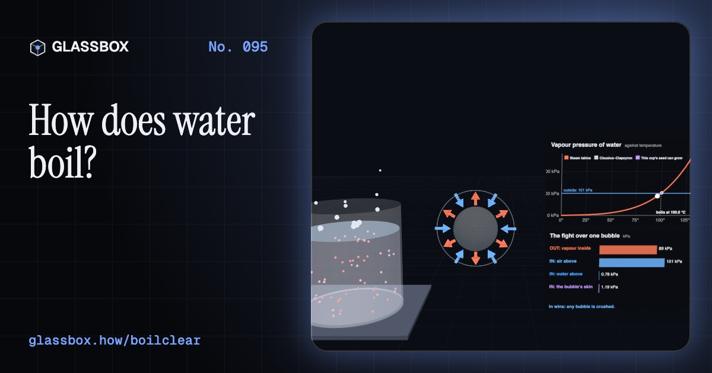
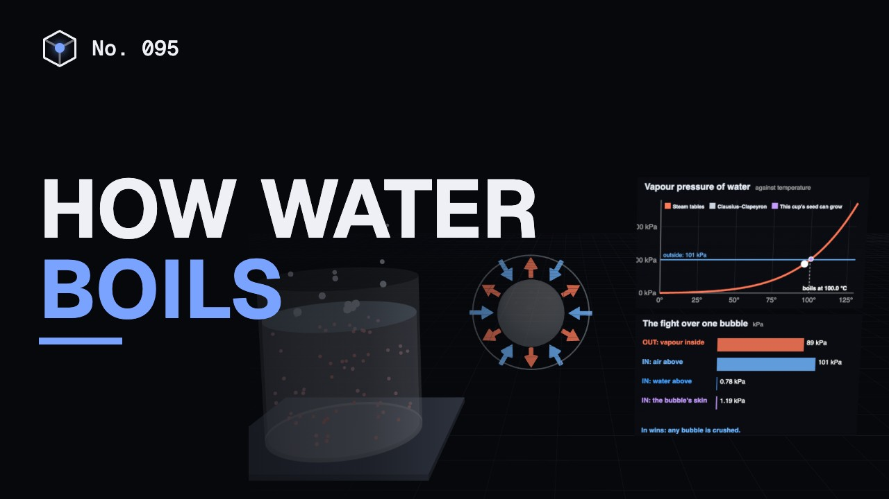
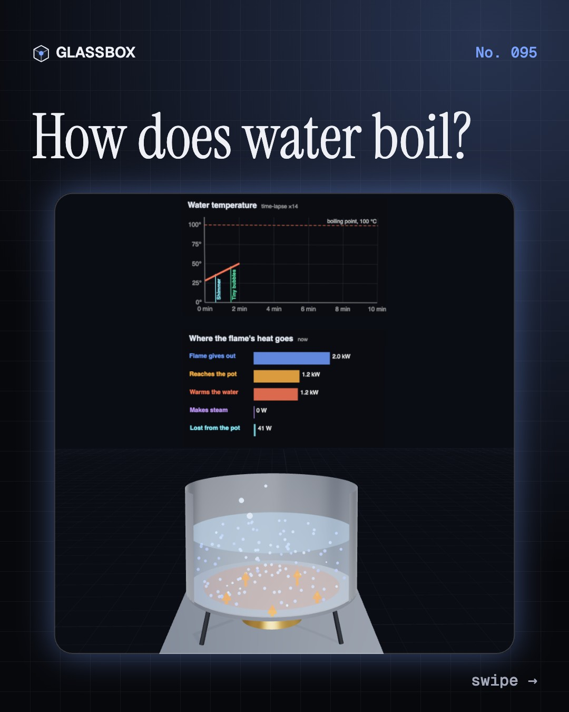
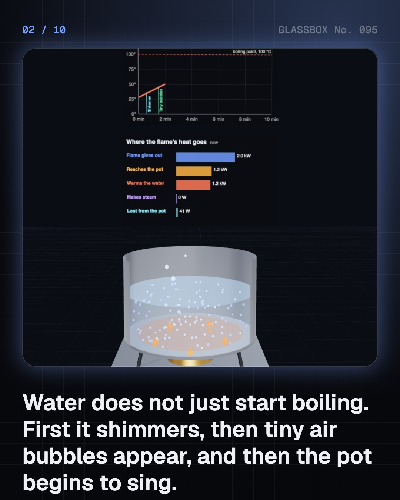
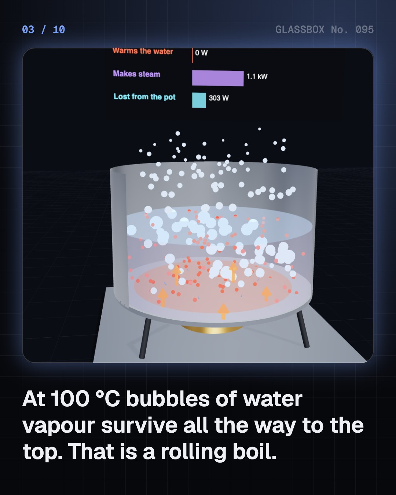
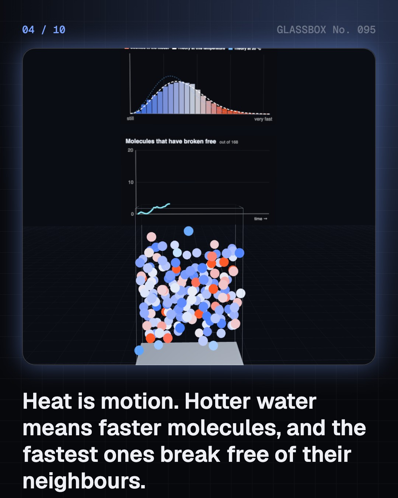

<!-- glassbox:start -->
<!-- Generated from glassbox.json by the Glassbox hub (npm run readme -- boilclear). Edit glassbox.json, not this block. -->
<p align="center"><a href="https://glassbox.how/e/boilclear/"></a></p>

<h1 align="center">BoilClear</h1>

<p align="center"><b>How does water boil?</b><br>Water does not boil because it reaches 100 °C. It boils when its vapour can push back as hard as the air presses down, which is why it boils at 88 °C in Leh and 120 °C in a pressure cooker. Heat a pot, watch the molecules and move the pressure yourself.</p>

<p align="center"><a href="https://glassbox.how/boilclear/"><b>▶ Play with it</b></a> &nbsp;·&nbsp; <a href="https://glassbox.how/e/boilclear/">Read the 60-second explainer</a> &nbsp;·&nbsp; <a href="https://glassbox.how/boilclear/glassbox/reel.mp4">Watch the 40-second video</a></p>

<p align="center">
  <a href="https://glassbox.how/e/boilclear/"></a>
  <a href="https://glassbox.how/e/boilclear/"></a>
  <a href="LICENSE"></a>
  <a href="LICENSE-CONTENT.md"></a>
  <a href="#privacy"></a>
</p>

## In 60 seconds

1. **A pot does not boil all at once.** Heat flows from the flame through the steel base into the water, and warm water rises while cool water sinks. First tiny bubbles of dissolved air appear, then the pot 'sings' as vapour bubbles form on the hot base and collapse, and at 100 °C bubbles finally reach the top.
2. **Temperature is motion.** Water molecules never stop moving, and temperature is their average kinetic energy. Hydrogen bonds hold the liquid together, but the fastest molecules at the surface break free at any temperature. That is evaporation.
3. **Boiling is a pressure contest.** A bubble inside water is squeezed by the air above. It can survive only when the water's vapour pressure equals the pressure outside, which at sea level happens at 100 °C. Bubbles also need a seed, so water in a smooth cup in a microwave can overheat and then erupt.
4. **Then the temperature stops.** At the boiling point, extra heat no longer warms the water. It tears molecules free, at 2,257 kJ for every kilogram: seven times the heat that took a litre from 25 °C to the boil. Steam hands that heat back when it condenses, which is why steam burns are so bad.
5. **Change the pressure, move the boiling point.** Water boils at about 97 °C in Bengaluru, 92 °C in Shimla, 88 °C in Leh and 70 °C on Everest. A pressure cooker holds about 2 atmospheres, so water stays liquid to about 120 °C and dal cooks in a quarter of the time. In a vacuum jar, water boils at room temperature.
6. **Salt, lids and safety.** A teaspoon of salt in a litre raises the boiling point by only about 0.1 °C, so it does not make water boil faster. A lid stops vapour carrying heat away and saves far more gas. Never force open a cooker under pressure, and cool a scald under running water for 20 minutes.

## Words worth knowing

| Term | Meaning |
|---|---|
| **Boiling point** | The temperature at which a liquid's vapour pressure equals the pressure around it. For water at sea level that is about 100 °C. |
| **Vapour pressure** | The pressure of the vapour a liquid gives off at a given temperature. It rises steeply as the liquid gets hotter. |
| **Latent heat of vaporisation** | The energy needed to turn a liquid into gas without changing its temperature: 2,257 kJ per kilogram for water at 100 °C. |
| **Evaporation** | Molecules escaping from the surface of a liquid. Unlike boiling, it happens at any temperature. |
| **Nucleation site** | A scratch or trapped air pocket where a bubble can start. Without one, water can become superheated. |
| **Clausius–Clapeyron equation** | The rule that links how fast vapour pressure climbs with temperature to the latent heat. It predicts the boiling point at any pressure. |
| **Gauge pressure** | Pressure measured above the surrounding air. A pressure cooker runs at about 1 kg/cm² of gauge pressure, about 2 atmospheres in total. |

## A short history

**From a spinning steam ball in Alexandria to the cooker whistle in an Indian kitchen: how people learned what boiling really is.**

- **60** · A ball that spins on steam (Hero of Alexandria, Alexandria, Roman Egypt)
- **1679** · The first pressure cooker (Denis Papin, Royal Society, London, England)
- **1724** · A reliable thermometer, and a clue (Daniel Gabriel Fahrenheit, Amsterdam, Dutch Republic)
- **1742** · A hundred steps between freezing and boiling (Anders Celsius, Uppsala, Sweden)
- **1762** · Hidden heat (Joseph Black, University of Glasgow, Scotland)
- **1765** · A separate condenser (James Watt, Glasgow, Scotland)
- **1834** · The slope of the boiling curve (Émile Clapeyron, Paris, France)
- **1866** · A height for Lhasa, from a boiling pot (Nain Singh Rawat, Kumaon, India, to Lhasa, Tibet)

The full story, with 28 moments, charts, people and 49 sources: [glassbox.how/e/boilclear/history](https://glassbox.how/e/boilclear/history/). The data lives in [`history.json`](history.json).

## Video and slides

Made with the Glassbox studio from this box's storyboard (`window.glassbox.director`). Free to reuse under CC BY 4.0.

<a href="https://glassbox.how/boilclear/glassbox/video.mp4"></a>

<p><a href="glassbox/slide-1.jpg"></a> <a href="glassbox/slide-2.jpg"></a> <a href="glassbox/slide-3.jpg"></a> <a href="glassbox/slide-4.jpg"></a></p>

| File | What | Size |
|---|---|---|
| [`glassbox/reel.mp4`](https://glassbox.how/boilclear/glassbox/reel.mp4) | Reel / Short, with captions and soundtrack | 1080×1920 |
| [`glassbox/video.mp4`](https://glassbox.how/boilclear/glassbox/video.mp4) | YouTube video, with captions and soundtrack | 1920×1080 |
| `glassbox/slide-1…10.jpg` | Instagram carousel | 1080×1350 |
| `glassbox/thumb.jpg` | YouTube thumbnail | 1280×720 |
| `glassbox/cover.jpg` | Share card and repo social preview | 1200×630 |
| [`glassbox/history-reel.mp4`](https://glassbox.how/boilclear/glassbox/history-reel.mp4) | “History in 10 moments” Reel / Short | 1080×1920 |
| `glassbox/history-slide-*.jpg` | History carousel | 1080×1350 |
| `glassbox/post.json` | Post copy and schedule used by the publish kit | |

## Privacy

This box has no accounts and no ads, and it ships its own fonts and libraries. When you run it yourself it sends nothing anywhere. On glassbox.how, the site's `/bar.js` also loads Glassbox's analytics: **Google Analytics** to count visits (it asks first in the EU, UK and Switzerland, and stays off when your browser sends Global Privacy Control or Do Not Track) and **ClickTrust** to detect bots.

It remembers a few things **in your own browser only**, and never sends them anywhere:

| Browser storage key | What it holds |
|---|---|
| `boilclear.v1` | Which chapters you have opened, your best quiz scores, and sound on or off. |

Exactly what each one sees is at [glassbox.how/privacy](https://glassbox.how/privacy/).

## Licences

- **Code:** [MIT](LICENSE). Use it, change it, ship it.
- **Explanations, text, images and videos** (`glassbox.json`, `glassbox/`): [CC BY 4.0](LICENSE-CONTENT.md). Credit “Glassbox, glassbox.how/e/boilclear”.
- **Third-party parts** keep their own licences: [three.js](https://threejs.org) (MIT), [Geist, Instrument Serif](https://openfontlicense.org) (SIL OFL 1.1).
- The Glassbox name and logo aren't covered by either licence. See the [terms](https://glassbox.how/terms/).

Found a mistake? [Open an issue](https://github.com/bdeeps/boilclear/issues). Corrections happen in public.
<!-- glassbox:end -->

## Run it

It's plain HTML, CSS and JavaScript. No build step and no dependencies. Run locally, it contacts no other website.

```bash
python3 -m http.server 8000
```

Three.js and the fonts ship in `vendor/` and `fonts/`, so it also works offline.

Then open http://localhost:8000.

## How it's built

| File | What |
|---|---|
| `index.html`, `css/app.css` | The page and its styles |
| `js/app.js`, `js/stage.js`, `js/ui.js`, `js/kit.js` | The shared Glassbox 3D engine: chapters, 3D stage, controls, quiz, video director |
| `js/boil.js` | The physics shared by every chapter: steam-table formulas (IAPWS-IF97), air pressure with height, surface tension, pot heat losses, the see-through pot and the chart boards |
| `js/chapters/*.js` | One file per chapter: the 3D model, controls, text, key terms, quiz and video scenes |
| `glassbox.json` | Title, question, explainer beats, key terms, browser storage and credits shown on glassbox.how |
| `reel` in each chapter | The storyboard the Glassbox studio records into short videos |
| `glassbox/` | The published video, slides, thumbnail and post copy |
| `fonts/`, `vendor/three/` | Self-hosted Geist and Instrument Serif (SIL OFL 1.1) and three.js (MIT) |
